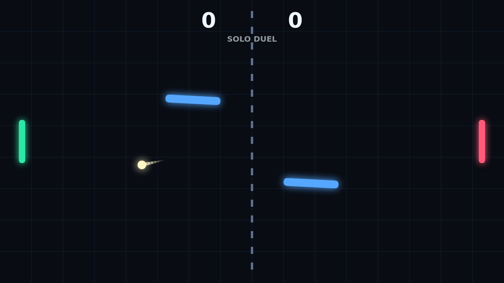

# Carom

Carom is a quick paddle duel played across a dark, electric court. The opening
serve is simple enough, but the first rebound off a moving obstacle changes the
shape of the point, forcing both players to read angles instead of just chasing a
straight line.

The trick is spin. Move a paddle as it strikes and the ball starts to curl,
turning a defensive return into a drifting shot that can sneak around the next
obstacle. Clean hits feel fast and readable; risky edge hits can turn into
beautiful recoveries.

Solo mode gives you the left paddle against a reactive defender, while Versus
puts both paddles on one keyboard. Matches run to win-by-two, so late points can
stretch into tense rallies where one bank shot decides everything.
